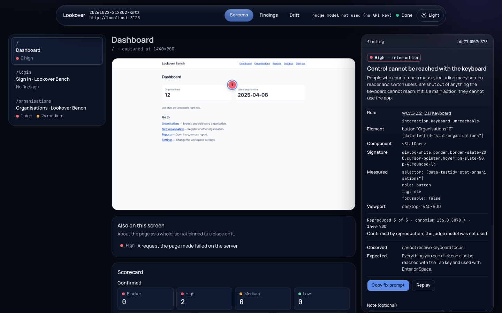

# Lookover

**On the bench app Lookover confirms 10 of 10 seeded issues and flags 0 of 3 clean controls; every finding is reproduced three times before it is reported.**

Lookover is an open-source design-and-QA reviewer that drives a web app in a real browser the way a senior front-end reviewer would, and reports what it can prove. It is built for people who came to coding through AI tools and ship real sites without anyone experienced checking their work.

<picture>
  <source media="(prefers-color-scheme: light)" srcset="docs/images/report-light.png">
  
</picture>

The report a run opens, in [dark](docs/images/report-dark.png) and [light](docs/images/report-light.png): a screen of the app with a numbered pin on each element a finding is about, and the chosen finding's rule, measurements and reproductions in the panel, its fix prompt one click from your clipboard.

**Status: v0 in progress — plan 03 is done: the judge reproduces every candidate before it is reported, any finding can be replayed (with Lookover or with a standalone Playwright script), and a live local report opens with each run. Next: the consistency lens and the benchmark.** Lookover maps your app, opening every screen it can reach in a real browser and recording what is on each one in `.lookover/app-map.json`, and inspects each screen as it goes: how its controls look when hovered and focused, whether a keyboard can reach them, whether their text can be read and they are big enough to tap, whether the page fits a phone, and what the console, the network and the page's text give away. Each candidate is then measured again in three fresh browser contexts, and only what reproduces every time is reported, in `.lookover/findings.json` and in the report. The plans are in [docs/superpowers/plans](docs/superpowers/plans); [how a run works](docs/how-it-works.md) describes the pipeline as built.

## Getting started

You need Node 22.12 or later and your app running locally. Next.js apps get their routes read from the filesystem as well; other apps are mapped by following links.

```sh
cd your-app
pnpm add -D @jayslifecode/lookover
pnpm lookover init   # a few questions; writes lookover.config.json and ignores .lookover/
pnpm lookover run    # opens the live report, inspects each screen in Chromium, reproduces what it finds
```

To try it once without adding a dependency: `pnpm dlx @jayslifecode/lookover init`, then `pnpm dlx @jayslifecode/lookover run`.

Lookover drives Chromium through Playwright. If Playwright's Chromium is not on your machine yet, install it once with `pnpm dlx playwright@1.64.1 install chromium`.

> **Not on npm yet.** Until the first release, build Lookover from a clone of this repository and use
> `node <clone>/packages/cli/dist/index.js` wherever this page says `pnpm lookover` or `lookover`:
>
> ```sh
> pnpm install
> pnpm --filter "./packages/**" build
> pnpm --filter @jayslifecode/lookover-core exec playwright install chromium
> ```

`init` asks for the URL your app runs at, its framework, whether every piece of data the app can reach is disposable, and how to log in. Only a "yes" to the disposable-data question unlocks **full** interaction (Lookover may click anything and submit any form); otherwise the config says **safe**. In scripts, pass the answers as flags: `pnpm lookover init --non-interactive --base-url http://localhost:3000`, adding `--interaction full --acknowledge-disposable-data` only when the data really is disposable.

A form login reads its credentials from `LOOKOVER_USERNAME` and `LOOKOVER_PASSWORD`; the config stores only the names of those variables, never the values.

To use a session you saved with Playwright instead, set `"auth": { "type": "storageState", "path": "state.json", "loginUrl": "/login" }` in `lookover.config.json`. A saved session cannot log in again, so if the app ends it during a run, Lookover stops with `E_AUTH_FAILED` and asks you to save it again. It can only tell from `loginUrl`: without it, a lost session goes unnoticed. The login page is mapped once, under its own URL (the screen it was reached from is recorded as `redirectedFrom`), and every later screen that redirects to it is skipped as a duplicate; a login URL that differs by query each time is mapped at most as often as one dynamic route is (two by default).

### The report

`lookover run` first serves a live report of the run on `127.0.0.1` and opens it in your browser: its first line is the URL, `Report: http://127.0.0.1:<port>/?token=<token>`. The report fills in as the run goes: screens as they are captured, findings as they are confirmed (on the bench the first one arrives about 7 seconds after the run starts). It shows each screen with a numbered pin on each element a finding is about (findings about the page as a whole are listed under the screenshot), the findings fix-first, what changed since the last run, and what the judge model cost. On a terminal, `lookover run` keeps serving it after the summary until you press Ctrl-C; in CI it closes with the run. `--no-open` serves it without opening a browser, and `--no-report` serves nothing. [How a run works](docs/how-it-works.md#stage-6-the-report) describes it, and [the report's design](docs/report-design.md) how it looks and moves.

To open a finished run's report again:

```sh
lookover report                                # the latest finished run, until Ctrl-C
lookover report --run 20261025-183458-ffhu     # any run, finished or not
lookover report --port 4000 --no-open          # a port of your choice; print the URL only
```

### What a run prints

A line per screen, a summary, and the confirmed findings, one line per rule. Against the seeded bench app in this repository (`lookover run --yes --no-report --max-screens 12`, without `ANTHROPIC_API_KEY`):

```text
Mapping http://localhost:3123 (run 20261025-183458-ffhu)
✓ /  12 elements · 0 forms · 3 candidates
✓ /login  9 elements · 1 form · 0 candidates
✓ /organisations  43 elements · 0 forms · 25 candidates
✓ /organisations/new  12 elements · 1 form · 0 candidates
✓ /reports  8 elements · 0 forms · 4 candidates
✓ /settings  10 elements · 1 form · 3 candidates
✓ /organisations/[id]  12 elements · 1 form · 1 candidate
✓ /organisations/[id]  12 elements · 1 form · 1 candidate

  Screens           8
  Elements          118
  Forms             5
  Backend hosts     none
  Blocked requests  0
  Run dir           .lookover/runs/20261025-183458-ffhu
  App map           .lookover/app-map.json
  Duration          21.1 s
  Confirmed         34
  Rejected          2
  Intended          0
  Worth a look      0
  Skipped           dev-overlay 2 · text-colour-uncertain:descendant 2
  Judge             harness only (no ANTHROPIC_API_KEY)
  Findings          .lookover/findings.json

  high    interaction.keyboard-unreachable    2  / button "Organisations 12"                     reproduced 3/3
  high    interaction.focus-visible-missing   1  /settings button "Save"                         reproduced 3/3
  high    interaction.horizontal-overflow     1  5 occurrences on 1 screen                       reproduced 3/3
  high    interaction.text-contrast-fail      1  /reports button "Export CSV"                    reproduced 3/3
  high    observers.raw-value                 1  2 occurrences on 2 screens                      reproduced 3/3
  high    observers.request-server-error      1  1 occurrence on 1 screen                        reproduced 3/3
  medium  interaction.target-size            24  /organisations link "Edit Northwind Logistics"  reproduced 3/3
  medium  observers.console-error             1  1 occurrence on 1 screen                        reproduced 3/3
  medium  observers.raw-i18n-key              1  1 occurrence on 1 screen                        reproduced 3/3
  low     interaction.positive-tabindex       1  1 occurrence on 1 screen                        reproduced 3/3

Findings were reproduced 3 times each but not reviewed by the judge model; set ANTHROPIC_API_KEY to enable it.
```

The progress lines count each screen's candidates, what the lenses measured before anything was judged. Each finding line gives the severity, the rule, how many confirmed findings it has, where to look first, and how often the first of them reproduced. The bench's issues are seeded on purpose (they are listed in [bench/README.md](bench/README.md)); the 24 target-size findings are the Edit and Copy email icons in the twelve rows of one table. The 2 rejected are the bench's timing control: a request on `/reports` that fails on the first two of every six loads, and the console error it logs. Neither reproduced three times out of three, so neither is reported. The `Skipped` row names the reasons the lenses most often left a measurement out for, with how many times (the full tally is `skipped` in `.lookover/findings.json`): a skip is a measurement that could not be trusted or was not reached, never a finding. Every finding is in `.lookover/findings.json` with what was expected and measured, its evidence, how it was reproduced and judged, and a fix prompt to paste into your coding agent ([the finding contract](docs/findings.md)).

| Flag                    | What it does                                                                                                   |
| ----------------------- | -------------------------------------------------------------------------------------------------------------- |
| `--headed`              | Shows the browser window.                                                                                      |
| `--max-screens <n>`     | Captures at most `n` screens this run, instead of `maxScreens` from the config (default 40).                   |
| `--allow-host <host>`   | Lets the browser load this host without asking, for this run only (CDNs, fonts). Repeatable.                   |
| `--confirm-host <host>` | Confirms a backend as a development or disposable instance and saves it to the config. Repeatable.             |
| `--yes`                 | Never prompts. A backend that is not confirmed stops the run instead.                                          |
| `--map-only`            | Only maps the app: runs no lens and no observer, so there are no candidates.                                   |
| `--lens <name>`         | Inspects each screen with this lens (repeatable). Today the only lens is `interaction`, the default.           |
| `--no-judge`            | Lists the candidates as measured: reproduces nothing and asks no judge model. Your intended decisions still apply. |
| `--judge-model <id>`    | The judge model for this run, instead of `model.judge` in the config (default `claude-sonnet-5-5`).            |
| `--no-report`           | Serves no live report.                                                                                         |
| `--no-open`             | Serves the live report but does not open it in the browser; its URL is printed.                                |

Each host flag takes one host: repeat it for more (`--confirm-host a.dev.test --confirm-host b.dev.test`), since a comma-separated list is refused.

Exit codes: `0` done, `1` the run failed, `2` the config or a flag is invalid, `3` refused (the disposable-data acknowledgement is missing, or a backend is not confirmed).

### The judge model and `ANTHROPIC_API_KEY`

Reproduction decides first: a candidate that does not reproduce in all three fresh browser contexts is rejected, whatever happens next. With `ANTHROPIC_API_KEY` set in the environment, Lookover also asks a judge model (Claude Sonnet 5.5 by default; `--judge-model` or `model.judge` in the config to change it) about each finding that reproduced. The model never drives the browser; it reads the finding's measurements and two crops at most, and may confirm the finding, or reject it as a measurement error or a case the standard exempts, with its reason. Its verdicts are cached in `.lookover/cache/judge/`, so a finding seen again, measured the same way, costs nothing. The summary's `Judge` row then reads `claude-sonnet-5-5 · <calls> calls (<hits> cached) · <tokens> tokens · ≈ $<cost>`, and the report's top bar shows `<calls> calls · <n>k tokens · ≈ $<cost>`, with the model, the cache hits and each kind of token in its tooltip. What a run with a key costs has not been measured yet. To measure it on the bench, run `LOOKOVER_E2E_MODEL=1 pnpm test:e2e` with `ANTHROPIC_API_KEY` set: the suite then keeps the key for its bench run, and the `Judge` row that run prints (kept in `packages/cli/.e2e/lookover-run.log`) gives its cost. The target the plan set is under $0.25 of model use for the bench run and under $1 for a 20-screen app, at the defaults; the run above, without a key, used none.

Without a key nothing is sent anywhere and nothing is lost: every finding that reproduced three times is confirmed by reproduction alone, and the run says so (`Judge  harness only (no ANTHROPIC_API_KEY)`). If the model fails during a run, the findings it has not judged yet are confirmed the same way, and the failure is noted. [Safety and privacy](docs/safety-and-privacy.md) lists exactly what a model call contains.

### Replaying and marking findings

Any finding can be measured again, in a browser you can watch, or written out as a script that needs nothing but Playwright:

```sh
lookover replay 3f44e1                    # the id from findings.json, or the start of it
lookover replay 3f44e1 --times 3 --headless
lookover replay 3f44e1 --script           # writes .lookover/replays/3f44e15e94c4.mjs
node .lookover/replays/3f44e15e94c4.mjs   # with playwright@1.64.1 and its Chromium installed
```

`lookover replay` prints a line per attempt and `reproduced <n>/<of>`, and exits 0 only when every attempt reproduced it.

A finding that is on purpose can be marked as intended, so later runs leave it out; the report's Mark intended button does the same:

```sh
lookover mark 3f44e1 intended --note "The focus ring is drawn by the parent card"
lookover mark 3f44e1 clear
```

The decisions are kept in `.lookover/decisions.json`. [The finding contract](docs/findings.md#decisions) has both commands in full, the standalone script's environment variables, and every field of a finding.

### What `.lookover/app-map.json` contains

- **`routes`**: every route pattern, in Next.js syntax (`/organisations/[id]`), from the filesystem or from links.
- **`screens`**: one per page visited (at the first viewport in the config, and by default at most two instances of one dynamic route), each with its URL, route pattern (matched on the path below the app's base path), title, whether it loaded (`status` is `captured`, or `navigation-failed` with the reason in `error` and nothing else captured), a screenshot, the interactive elements (role, accessible name, a selector, position, whether it is disabled or focusable), the forms (each field's label and where the label came from, type, required, pattern and length limits, and the submit button), the design tokens it renders (colours, font sizes and families, radii, spacing, with how often each appears) and the links to other screens of the app. When the app redirects a page to another screen of itself, the screen is recorded once, under the URL it landed on, and `redirectedFrom` holds the URL that was asked for (it is `null` otherwise). A selector is one that finds the element in the live page and that redaction leaves unchanged.

`.lookover/app-map.json` and `.lookover/findings.json` are always the latest run's. Each run also keeps its own copies, an append-only event log (`run.jsonl`) and its screenshots and other evidence under `.lookover/runs/<run id>/`. Your decisions, the judge's verdict cache and the replay scripts sit beside them. Values that look like secrets are redacted in the map, the findings, the evidence and the log; [safety and privacy](docs/safety-and-privacy.md#what-is-stored-under-lookover) lists everything stored.

### Backends and other hosts

The browser only opens your app: `localhost`, `127.0.0.1`, `::1`, any `*.local` or `*.localhost` name, and the hosts in `allowHosts`. Requests to payment, email and SMS providers are blocked unless you add them to `allowHosts`. Any other host the app itself calls (a hosted database, an auth service, an API) is treated as a backend. Before logging in, Lookover opens a few pages without submitting anything; the app's own requests from those pages do reach its backends, which is how Lookover learns what they are. It then lists those backends, none of them selected, and asks you to select each one that is a development or disposable instance; pressing Enter without selecting confirms nothing. The run does not go on until every backend on the list is confirmed, and from then on every request to a backend that is not confirmed is blocked; one first called later in the run is listed at the end.

- **Confirming backends.** Answer the prompt, or pass `--confirm-host <host>` (once per host) to confirm them from the start, which is what `--yes` and CI need. Confirmed hosts are saved to `confirmedBackendHosts` in `lookover.config.json`, so later runs do not ask again; you can also edit that list by hand.
- **CDNs and fonts.** Images, scripts and fonts from another host count as calls to a backend too. Add hosts such as `fonts.gstatic.com` or `*.your-cdn.com` to `allowHosts` in `lookover.config.json` (or pass `--allow-host` for one run); otherwise Lookover asks you to confirm them, and blocks them when they first appear after that step. A host the app only loaded such static assets from is listed as `(static assets — consider allowHosts)`. A host in `allowHosts` is never asked about at all, so real backends do not belong there: confirm them instead.

## What it finds

Every finding names a rule from [the rules catalogue](docs/rules.md), and its severity is the rule's. [The interaction lens and the observers](docs/lenses/interaction.md) describes what each check measures, its exact threshold and every exemption.

**The interaction lens**, on each screen's controls:

- Keyboard focus is not visible
- The focus indicator is too faint
- No hover feedback on a clickable control (listed under "worth a look", not as a finding)
- Text is unreadable against its background
- Text contrast is below the minimum
- Tap target is smaller than 24 by 24 pixels
- Control cannot be reached with the keyboard
- A positive tabindex forces a custom focus order
- Keyboard focus lands on something that cannot be seen
- Keyboard focus gets stuck
- The page scrolls sideways at this screen size
- Text is cut off without an ellipsis

**The observers**, on everything the page does while it loads:

- The page threw an error that nothing caught
- The page logged an error to the console
- The page logged a warning (worth a look)
- A request the page made failed on the server
- A request the page made was rejected
- A request the page made never got an answer
- A placeholder value leaked into the page (`undefined`, `NaN`, `[object Object]`)
- A template placeholder was not filled in (`{{name}}`, `{count}`)
- A translation key is shown instead of its text (`settings.timezone.hint`)

Every check is a measurement: when one cannot be trusted (text over a background image, a photo or anything else painted under it, a colour that cannot be read, an element that left the page) it is skipped and the reason recorded, never guessed. What a check finds is a candidate until the judge has measured it again three times; only what reproduces every time is reported.

## What it will not do

- Report what it could not reproduce. A finding is listed only when it reproduced in three fresh browser contexts out of three; the rest are set aside as rejected, with the reason. With `--no-judge` nothing is reproduced, and the CLI says the candidates were not.
- Act on data while it inspects. The interaction lens forces hover and focus styles, moves focus, presses Tab, resizes the window and reloads the screen it is on; it never clicks, types, submits a form or opens another page. Reproducing and replaying a finding does the same, on the finding's own screen.
- Act on data you have not declared disposable: full interaction needs the acknowledgement in the config. Before you confirm the backends, Lookover only opens a few pages, before logging in and without submitting anything; with a saved session, that session's cookies are sent with the probe's requests (and the app's own requests from those pages do reach its backends). After that, every backend you have not confirmed is blocked.
- Store or log your credentials: they are read from environment variables, kept out of errors and logs, and the saved session is readable only by you.
- Send your data to anyone: Lookover's only outside calls are judge model calls, made only when `ANTHROPIC_API_KEY` is set and [documented in full](docs/safety-and-privacy.md); the other requests that leave your machine are the ones your app makes to its own backends. The report is served on `127.0.0.1` only, behind a token, and loads nothing from anywhere else.
- Test apps you do not run yourself. There is no hosted mode.

## Privacy

What leaves your machine (only judge model calls, and what is in each), what the report server exposes and to whom, and what is stored under `.lookover/` are in [safety and privacy](docs/safety-and-privacy.md).

## Licence

[MIT](LICENSE)
