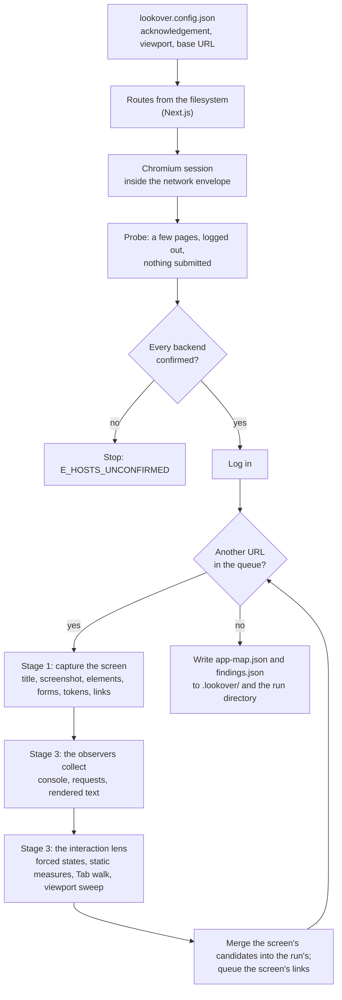

# How a run works

`lookover run` is a pipeline. The design ([spec §4](superpowers/specs/2026-10-20-lookover-design.md))
has six stages; this page describes the two that are built: **Stage 1**, which maps the app, and
**Stage 3**, in which the interaction lens and the observers inspect every screen. Everything here is
measured in a real browser; no model is called yet. The rest arrives in later releases: Stage 2 (rules
read from your code, for the behaviour lens), Stage 4 (consistency across screens), Stage 5 (the judge,
which re-runs each candidate before it is reported) and Stage 6 (the report).

## Before the browser starts

The config is loaded and checked: a config that allows `full` interaction must carry the
disposable-data acknowledgement (`E_ACK_REQUIRED` otherwise), at least one viewport must be configured,
and the base URL must be on a host the browser may open. For a Next.js app the routes are read from the
`app/` directory, each logged as `route.discovered`.

The run gets its directory, `.lookover/runs/<run id>/` (the id is the local date and time and four
random characters, `20261022-034634-lkv1`), with its log, `run.jsonl`, and its evidence folder.

## The browser and the network envelope

One Chromium session, driven through Playwright, at the first configured viewport. The browser only
opens your app: `localhost`, `127.0.0.1`, `::1`, `*.local` and `*.localhost` names, and the hosts in
`allowHosts`. Requests to payment, email and SMS providers are blocked. Any other host the app calls is
treated as a backend.

Before logging in, Lookover opens a few pages without submitting anything: the base URL, one more
static route and the login page of a form login. The hosts the app calls from them are logged as
`host.observed`, and every backend that is neither allowed nor already confirmed has to be confirmed as
a development or disposable instance (at the prompt, or with `--confirm-host`). The run does not go on
until each one is (`E_HOSTS_UNCONFIRMED`). From then on, every request to a backend that is not
confirmed is blocked and logged as `request.blocked`. Then the session logs in as the config says
(`auth.completed`).

## Stage 1: the App Map

The crawl walks the app breadth first, from `/` and every static route, with one page:

1. **Load.** Each URL is opened and allowed to settle: the `load` event, then up to 800 ms for the
   network to go quiet and up to 2 s for the page's fonts. `screen.discovered` is logged first.
2. **Capture.** The screen's title; a full-page screenshot; its interactive elements, from Chromium's
   accessibility tree (role, accessible name, a selector that finds exactly that element, its box,
   whether it is disabled or focusable; at most 500, beyond which `screen.truncated` is logged); its
   forms and fields with their labels and rules; the design tokens it renders (colours, font sizes and
   families, radii, spacing); and its links to other screens of the app. Logged as `screen.captured`.
3. **Inspect** (Stage 3, below), on the page still showing the screen.
4. **Queue the links.** A link off the app, a destructive link (log out, delete, reset), a route pattern
   already queued `maxPerRoute` times (two by default) and anything past `maxScreens` (40 by default) is
   skipped and logged as `screen.skipped` with its reason.

A page that redirects inside the app is recorded once, under the URL it landed on, with `redirectedFrom`
set; landing on a screen captured before is skipped as `redirected-duplicate`. A navigation that fails
is still a screen, with status `navigation-failed` and the reason, so dead links show up. If the session
is lost, a form login logs in again once (`auth.lost`); a saved session cannot, and the run stops with
`E_AUTH_FAILED`.

At the end the App Map is written, redacted, to `.lookover/app-map.json` and to the run directory.

## Stage 3: inspecting each screen

Each captured screen is inspected as soon as it is captured, before the crawl moves on:

1. **The observers collect** what the page did while the screen loaded: console errors, warnings and
   uncaught exceptions, every request and its answer, and the text it shows. They run first, before
   anything reloads or resizes the page. Each keeps its own evidence per screen.
2. **The interaction lens inspects** the screen: forced hover, focus and pressed states, text contrast,
   target size and keyboard reach, the Tab walk, and the viewport sweep. It has 10 seconds, and records
   what it skipped and why. The capture viewport is restored after it, whatever it did.
3. **The candidates are merged** into the run's: a finding seen before (the same id) gains the new
   occurrences, and each id seen for the first time is logged as `finding.candidate`. Worth-a-look
   entries are kept apart and not logged.
4. **`screen.inspected`** is logged with what the screen yielded, what was skipped and any error.

An error Lookover raises itself (a `LookoverError`) fails the run. Any other error from an observer
or the lens stops only that screen's inspection: what it yielded so far is kept, the first line of the
message is the event's `error`, the CLI prints it as a warning, and the crawl goes on.

When the crawl is done, the findings are written, redacted, to `.lookover/findings.json` and to the run
directory (see [the finding contract](findings.md)). What each check measures, and every exemption, is
in [the interaction lens and the observers](lenses/interaction.md).

## The run log

`run.jsonl` holds one JSON event per line, in order, each with `seq` (1, 2, 3, … with no gaps), `at`
(ISO 8601) and `runId`. Every event is redacted before it is written. It is the record of the run; the
CLI's progress lines are printed from the same events.

| Event | When | What it carries |
| --- | --- | --- |
| `run.started` | first | `baseUrl`, `interaction` (`full` or `safe`), `viewports` |
| `route.discovered` | a route read from the filesystem | `route` |
| `host.observed` | a host the app sent a request to, once per kind | `host`, `kind` (`navigation`, `app-call`, `subresource`) |
| `request.blocked` | a request the network envelope stopped | `url`, `reason` (`provider`, `host-not-allowed`, `unconfirmed-backend`) |
| `auth.completed` | the session logged in | `method` (`none`, `storageState`, `form`), `statePath` |
| `auth.lost` | the session was lost during the crawl | `url` |
| `screen.discovered` | before a URL is visited | `url`, `from` |
| `screen.skipped` | a URL that is not visited | `url`, `reason` (`destructive-link`, `route-cap`, `max-screens`, `not-same-app`, `redirected-duplicate` with `landed`) |
| `screen.captured` | a screen is in the map | `screen` |
| `screen.truncated` | a screen had more than 500 interactive elements | `screenId`, `elements`, `kept` |
| `finding.candidate` | a candidate seen for the first time in the run | `finding`, as merged so far |
| `screen.inspected` | the observers and the lens are done with a screen | `screenId`, `durationMs`, `candidates`, `worthALook`, `skipped` (`{ reason, count }[]`), `error` |
| `run.finished` | last, on success | `screens`, `durationMs` |
| `run.failed` | last, on failure | `error` (`code`, `message`) |
