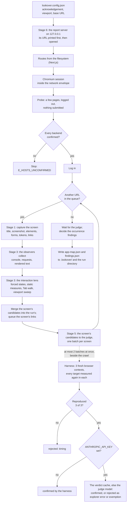

# How a run works

`lookover run` is a pipeline. The design ([spec §4](superpowers/specs/2026-10-20-lookover-design.md))
has six stages; this page describes the four that are built: **Stage 1**, which maps the app;
**Stage 3**, in which the interaction lens and the observers inspect every screen; **Stage 5**, in which
the judge reproduces every candidate before it is reported; and **Stage 6**, the live report. Everything
is measured in a real browser. The only model Lookover calls is the judge's, only when
`ANTHROPIC_API_KEY` is set, and only about findings that have already reproduced. Two stages arrive in
later releases: Stage 2 (rules read from your code, for the behaviour lens) and Stage 4 (consistency
across screens).

## Before the browser starts

The config is loaded and checked: a config that allows `full` interaction must carry the
disposable-data acknowledgement (`E_ACK_REQUIRED` otherwise), at least one viewport must be configured,
and the base URL must be on a host the browser may open.

The run gets its directory, `.lookover/runs/<run id>/` (the id is the local date and time and four
random characters, `20261022-034634-lkv1`), with its log, `run.jsonl`, and its evidence folder.

The judge is set up next (unless `--map-only`, which inspects nothing): the project's decisions are read
from `.lookover/decisions.json` (a file that cannot be read fails the run with `E_RUN_FAILED`), and the
judge model is chosen, `--judge-model` or else `model.judge` in the config (`claude-sonnet-5-5` by
default), if `ANTHROPIC_API_KEY` holds a key. With `--no-judge` the judge only applies the decisions.

Then, unless `--no-report`, the report server starts (Stage 6, below) and its URL is the first line
`lookover run` prints. The run itself begins after it: `run.started` is logged and, for a Next.js app,
the routes are read from the `app/` directory, each logged as `route.discovered`.

## The browser and the network envelope

One Chromium session, driven through Playwright, at the first configured viewport. The browser only
opens your app: `localhost`, `127.0.0.1`, `::1`, `*.local` and `*.localhost` names, and the hosts in
`allowHosts`. Requests to payment, email and SMS providers are blocked. Any other host the app calls is
treated as a backend.

Before logging in, Lookover opens a few pages without submitting anything: the base URL, one more
static route and the login page of a form login. The hosts the app calls from them are logged as
`host.observed`, and every backend that is neither allowed nor already confirmed has to be confirmed as
a development or disposable instance (at the prompt, or with `--confirm-host`). The run does not go on
until each one is (`E_HOSTS_UNCONFIRMED`). From then on, every request to a backend that is not
confirmed is blocked and logged as `request.blocked`. Then the session logs in as the config says
(`auth.completed`).

The judge is handed the session as soon as it exists, before the probe: its reproductions open browser
contexts of their own in the same browser, under the same network policy.

## Stage 1: the App Map

The crawl walks the app breadth first, from `/` and every static route, with one page:

1. **Load.** Each URL is opened and allowed to settle: the `load` event, then up to 800 ms for the
   network to go quiet and up to 2 s for the page's fonts. `screen.discovered` is logged first.
2. **Capture.** The screen's title; a full-page screenshot; its interactive elements, from Chromium's
   accessibility tree (role, accessible name, a selector that finds exactly that element, its box,
   whether it is disabled or focusable; at most 500, beyond which `screen.truncated` is logged); its
   forms and fields with their labels and rules; the design tokens it renders (colours, font sizes and
   families, radii, spacing); and its links to other screens of the app. Logged as `screen.captured`.
3. **Inspect** (Stage 3, below), on the page still showing the screen.
4. **Queue the links.** A link off the app, a destructive link (log out, delete, reset), a route pattern
   already queued `maxPerRoute` times (two by default) and anything past `maxScreens` (40 by default) is
   skipped and logged as `screen.skipped` with its reason.

A page that redirects inside the app is recorded once, under the URL it landed on, with `redirectedFrom`
set; landing on a screen captured before is skipped as `redirected-duplicate`. A navigation that fails
is still a screen, with status `navigation-failed` and the reason, so dead links show up. If the session
is lost, a form login logs in again once (`auth.lost`); a saved session cannot, and the run stops with
`E_AUTH_FAILED`.

At the end the App Map is written, redacted, to `.lookover/app-map.json` and to the run directory.

## Stage 3: inspecting each screen

Each captured screen is inspected as soon as it is captured, before the crawl moves on:

1. **The observers collect** what the page did while the screen loaded: console errors, warnings and
   uncaught exceptions, every request and its answer, and the text it shows. They run first, before
   anything reloads or resizes the page. Each keeps its own evidence per screen.
2. **The interaction lens inspects** the screen: forced hover, focus and pressed states, text contrast,
   target size and keyboard reach, the Tab walk, and the viewport sweep. It has 10 seconds, and records
   what it skipped and why. The capture viewport is restored after it, whatever it did.
3. **The candidates are merged** into the run's: a finding seen before (the same id) gains the new
   occurrences, and each id seen for the first time is logged as `finding.candidate`. Worth-a-look
   entries are kept apart and not logged.
4. **`screen.inspected`** is logged with what the screen yielded, what was skipped, the screen's state
   gallery (`gallery`, the evidence the report shows it from) and any error.
5. **The judge is handed** the screen's own candidates and worth-a-look entries (Stage 5, below), and
   the crawl moves on without waiting for it.

An error Lookover raises itself (a `LookoverError`) fails the run. Any other error from an observer
or the lens stops only that screen's inspection: what it yielded so far is kept, the first line of the
message is the event's `error`, the CLI prints it as a warning, and the crawl goes on.

When the crawl is done and the judge has decided, the findings are written, redacted, to
`.lookover/findings.json` and to the run directory (see [the finding contract](findings.md)). What each
check measures, and every exemption, is in [the interaction lens and the observers](lenses/interaction.md).

## Stage 5: the judge

Reproduction is the oracle. A candidate reaches the report only if a separate harness, which never
drove the crawl, measures it again three times (`REPRODUCTION_ATTEMPTS = 3`) and sees it every time.
The source is `packages/judge/`.

**What is reproduced.** Each inspected screen's candidates are first checked against the project's
decisions: a finding whose id is in `.lookover/decisions.json` is **intended**. It is logged at once as
`finding.judged` (decided by the user, nothing reproduced), never reproduced, never sent to a model and
never listed as a finding. The rest become one **batch** for the screen: a step finding is a target of
its own screen, and an occurrence finding is a target for each of its occurrences on that screen. A
step finding already queued from an earlier screen (the same id, such as the same control on a second
instance of a dynamic route) is not queued again. Worth-a-look entries are neither reproduced nor
judged; they pass through as they are.

**The harness.** Batches run at most two at a time (`JUDGE_CONCURRENCY = 2`), beside the crawl, which
keeps its own page. For each batch the harness makes three **attempts**, one after the other. One attempt
is a new browser context created from a snapshot of the session's storage state (its cookies and local
storage, so the login carries over and nothing else of the crawl's page does), with fresh observers
attached, the screen's URL loaded and settled as the crawl settles it, and its interactive elements read
again. Every target of the batch is then measured on that one load, observer findings first (the
observers hold what the load produced, and a lens may reload the page), then each lens's in the order of
its rules. A lens finding is measured by the lens that reported it, re-running the step that reports
its rule for that target ([how the interaction lens reproduces a finding](lenses/interaction.md#reproducing-a-finding));
an observer finding has reproduced when a fresh observer reports the same finding id on the screen. Each
target gets 10 seconds of its own (`PER_SCREEN_BUDGET_MS`), counted from when its measurement starts.
Each attempt of each target is stored as `reproduction-<finding id>` JSON evidence (the attempt, the URL,
what was measured and the environment), and the context is closed whatever happened. An error in one
attempt makes that attempt not reproduced, with `skipped: "error:<first line of the message>"`, and the
other attempts still run; a `LookoverError` fails the run.

**The rule.** A step finding is **confirmed** only when all three attempts reproduced it. An occurrence
finding keeps the occurrences that reproduced in all three attempts (the others go to
`droppedOccurrences`, and its fix prompt is rebuilt to list the kept ones) and is confirmed when at least
one occurrence was kept. Anything less is **rejected** with the attribution `timing` and a note,
`Reproduced 2 of 3 times; a problem that comes and goes is not reported`, and no model is asked about it.
A rejected occurrence finding keeps every occurrence, so the record still says where it was seen. On the
bench, the timing control (`control-004`, a request that fails on the first two of every six loads) and
the console error it logs are rejected this way.

**When it is decided.** A step finding is decided as soon as its batch is back, and logged as
`finding.judged`, so confirmed findings stream into the run log while the crawl goes on: on the bench the
first one arrives about 7 seconds after `run.started`. An occurrence finding can gain occurrences on later
screens, so it is decided once the crawl is done, when every batch is back, and logged then.

**The model.** With `ANTHROPIC_API_KEY` set, the judge model is asked about each finding that reproduced
(a step finding at 3 of 3, or an occurrence finding's kept occurrences). It holds no browser tools and
cannot run anything: it reads one bundle (the rule, the finding, its measured facts, up to two crops, the
attempts and the environment; [what is in it](safety-and-privacy.md#what-a-judge-call-contains)) and
answers with a structured verdict. It may confirm the finding as a `product-defect`, or reject it for one
of two reasons only, given in its note: `explorer-error` (the measurement misread the element) or
`exemption` (the standard behind the rule exempts this case). It can never confirm a finding that did not
reproduce, since it is never asked about one, never adds a finding and never changes a severity. Every
page-derived string in the bundle is redacted, then wrapped as untrusted data that the system prompt
tells it never to follow. A verdict that contradicts itself (a confirmation that is not a product
defect, a rejection without a reason) counts as a model error.

The request: `client.messages.parse` on `model.judge` (default `claude-sonnet-5-5`), `effort: 'low'`,
`max_tokens: 1024`, the system prompt as one cached block (`cache_control: { type: 'ephemeral' }`), a
60-second timeout and two retries (the SDK retries 408, 409, 429, 5xx and connection errors), and the
SDK's own logging off.

**Without a key, nothing is lost.** The harness decides alone: a finding that reproduced is confirmed
(`decidedBy: "harness"`, `attribution: "product-defect"`), `judge.unavailable` is logged once with the
reason `no-api-key`, and the summary says the judge model was not used. If the model fails (an API
error after the retries, a refusal, an answer that is not a verdict), the first failure is logged as
`judge.unavailable` with the reason `api-error`; that finding and every later one is confirmed by the
harness, its note saying the model was unavailable and why. A model failure never loses a reproduced
finding.

**The verdict cache.** Before a call, the judge looks in `.lookover/cache/judge/<hash>.json`, where the
hash is the SHA-256 of the prompt's version, the model id, the bundle's text and the crops' ids. Nothing
in the bundle depends on when it was built (no time, no duration), so the same finding measured the same
way on a later run is answered from the cache: `cached: true`, no tokens, no cost. Every verdict the
model gives is cached, redacted. Delete the directory to ask again.

**Cost.** Every call records its token use (`input`, `output`, `cacheRead`, `cacheWrite`) and an estimate
in US dollars from the price table in `packages/judge/src/model/pricing.ts` (Sonnet 5.5 at $2 per
million input tokens and $10 per million output; cache reads at 0.1 times the input price, cache writes
at 1.25 times, for every model in the table, so an Opus 5.5 estimate overstates its cache reads, which
cost it 0.05 times). A model the table does not know gets no estimate. The run's totals are `judge` in
`findings.json`, the `Judge` row of the summary (shaped
`claude-sonnet-5-5 · <calls> calls (<hits> cached) · <tokens> tokens · ≈ $<cost>`, or
`harness only (no ANTHROPIC_API_KEY)` when no model was used) and the cost readout in the report's top
bar. The design's ceiling is $0.25 of model use for the bench run and $1 for a 20-screen app at the
defaults ([spec §3](superpowers/specs/2026-10-20-lookover-design.md#3-constraints)).

**The end of the run.** Once the crawl is done (and the run log is known to hold every event so far), the
engine waits for every batch, decides the occurrence findings, and writes the judged file: the confirmed
findings in `findings`, the rest in `rejected` and `intended`, with the judge's totals and environment.
A batch that fails on anything but a model error (a `LookoverError`, evidence that cannot be read) fails
the run.

With `--no-judge`, nothing is reproduced and no model is asked: the candidates are written as measured,
except the intended ones, which the decisions still move to `intended`; `judge.unavailable` is logged
with the reason `disabled`.

## Stage 6: the report

`lookover run` serves a live report of the run while it goes on, and `lookover report` serves a finished
one. The server is in `packages/cli/src/report/`, the report itself (a static Vite build of React,
Tailwind and shadcn) in `packages/report/`, and the contract between them in
`packages/report/node/api.ts`.

**The server.** It listens on `127.0.0.1` only, on a port the system picks (`lookover report --port`
chooses one). It starts as soon as the run directory exists, before the browser does; `lookover run`
prints its URL first, `http://127.0.0.1:<port>/?token=<token>`, and opens it in your browser unless
`--no-open`. The token is 32 random hex digits, new for every server. Opening the URL sets it as a cookie
(`lookover_token_<port>`, `HttpOnly`, `SameSite=Strict`) and redirects to `/`, so the token leaves the
address bar. Every `/api/*` request needs the token (the cookie, or an `X-Lookover-Token` header), every
request must name the server in its `Host` (`127.0.0.1:<port>` or `localhost:<port>`), and a write must
come from the report's own origin. [Safety and privacy](safety-and-privacy.md#the-report-server) has the
details.

**What it serves.** The built report for `/`; the run's manifest (`GET /api/run`: the run id, base URL,
when it started, whether it is `running`, `finished` or `failed`, the previous finished run and the
Lookover version); the run log as an event stream (`GET /api/events`); the run's `app-map.json`,
`findings.json` and the project's `decisions.json`; the previous finished run's findings, for drift; and
the evidence under the run's `evidence/` directory, nothing outside it. Two writes: `POST /api/decisions`
records or clears a "mark as intended" decision in `.lookover/decisions.json`, and `POST /api/replay`
measures a finding again as `lookover replay` does, in a headed browser, one replay at a time (409 while
another runs, and 409 "Replay is available when the run finishes" while the run goes on, since its browser
session is busy). A decision made while the run goes on is checked against the findings the run log names
and recorded for the next run. Errors answer `{ "error": "<message>" }`.

**Live, from the run log.** The event stream sends every event already in `run.jsonl`, then each one
appended to it (the log is read every 250 ms, whole lines only, so a line still being written waits for
the next read), as `id: <seq>` and `data: <event>`, with a heartbeat every 15 seconds. A browser that
reconnects sends the last id it saw and is sent only what came after. The report builds its view from the
events as they arrive; once the run is over, it loads `findings.json`, which replaces what the events
built, and the decisions and the previous run's findings beside it.

**What the report shows.** The routes are in the URL's hash, so the static build needs no server routing,
and each takes `?f=<finding id>` for the finding shown in the panel:

- `#/screens/<screen id>`: the screen list; the screen's screenshot with a numbered pin on each confirmed
  step finding's element (numbered in fix-first order; pins closer than 24 px cluster into one); the
  findings about the page as a whole, listed under it; the scorecard (confirmed findings by severity,
  worth a look, how many reproduced every time, how many were rejected, the most frequent skips); and the
  state gallery (each control in each state it was put in, then the focus order).
- `#/findings`: the confirmed findings, fix-first, grouped by the component they share (the class
  signature), filtered by severity, lens and text; the findings marked intended; and, behind the Worth a
  look switch, the lower-confidence entries in a section of their own. While the run goes on, the
  candidates not judged yet are listed as being reproduced.
- `#/drift`: this run against the previous one: new, fixed, still there, marked intended since, and the
  routes that came and went.

The finding panel shows the chosen finding: its severity and lens, title, why it matters, the rule and
its standard, the element, the measured facts, how it was reproduced and judged (how many times of how
many, in which browser and viewport, who decided, the attribution and the judge's note), its crops and
screenshots, observed against expected, and three actions: Copy fix prompt, Replay, and Mark intended
with an optional note. With nothing chosen it shows the run's summary. The top bar names the run, holds the view switcher, says where the run is (mapping, inspecting,
judging, done or failed) and shows what the judge model cost once the run is over. How it looks and
moves is in [the report's design](report-design.md).

On a terminal, `lookover run` keeps serving the report after its summary until Ctrl-C; otherwise (in
CI, or piped) the server closes with the run. `--no-report` serves nothing.

## The run log

`run.jsonl` holds one JSON event per line, in order, each with `seq` (1, 2, 3, … with no gaps), `at`
(ISO 8601) and `runId`. Every event is redacted before it is written. It is the record of the run; the
CLI's progress lines are printed from the same events, and the report is built from them as they are
appended.

| Event | When | What it carries |
| --- | --- | --- |
| `run.started` | first | `baseUrl`, `interaction` (`full` or `safe`), `viewports` |
| `route.discovered` | a route read from the filesystem | `route` |
| `host.observed` | a host the app sent a request to, once per kind | `host`, `kind` (`navigation`, `app-call`, `subresource`) |
| `request.blocked` | a request the network envelope stopped | `url`, `reason` (`provider`, `host-not-allowed`, `unconfirmed-backend`) |
| `auth.completed` | the session logged in | `method` (`none`, `storageState`, `form`), `statePath` |
| `auth.lost` | the session was lost during the crawl | `url` |
| `screen.discovered` | before a URL is visited | `url`, `from` |
| `screen.skipped` | a URL that is not visited | `url`, `reason` (`destructive-link`, `route-cap`, `max-screens`, `not-same-app`, `redirected-duplicate` with `landed`) |
| `screen.captured` | a screen is in the map | `screen` |
| `screen.truncated` | a screen had more than 500 interactive elements | `screenId`, `elements`, `kept` |
| `finding.candidate` | a candidate seen for the first time in the run | `finding`, as merged so far |
| `screen.inspected` | the observers and the lens are done with a screen | `screenId`, `durationMs`, `candidates`, `worthALook`, `skipped` (`{ reason, count }[]`), `gallery` (the screen's state gallery, an evidence ref, or `null`), `error` |
| `judge.unavailable` | once, when the judge model is not used: as the judge is handed the session for `no-api-key` and `disabled` (`--no-judge`), at the first model failure for `api-error` | `reason` (`no-api-key`, `disabled`, `api-error`), `message` |
| `finding.judged` | a finding decided: an intended one as soon as its screen is inspected, a step finding when its batch is back, an occurrence finding at the end of the crawl | `finding`, whole, with its `status` and `judgement` |
| `run.finished` | last, on success | `screens`, `durationMs`, `confirmed`, `rejected`, `intended`, `worthALook`, `judge` (the judge's totals, or `null` for a run that was not judged) |
| `run.failed` | last, on failure | `error` (`code`, `message`) |

A `finding.judged` event can arrive after `run.failed`: a batch that was already running when the crawl
failed may still log its decision. The report ignores those.
